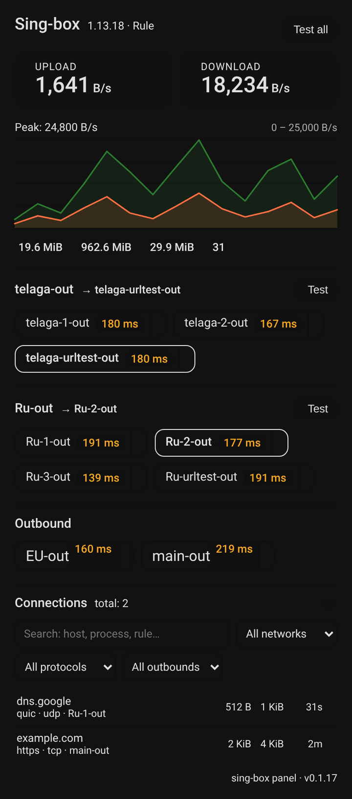

# sing-box for Home Assistant

[](https://github.com/Ghost-in-the-dark/ha-singbox/releases)
[](https://hacs.xyz)
[](https://github.com/Ghost-in-the-dark/ha-singbox/actions/workflows/validate.yaml)
[](LICENSE)

A Home Assistant integration that **monitors and controls** a running
[sing-box](https://sing-box.sagernet.org/) instance: live traffic, memory and
connections as sensors, every outbound group as a switch on your dashboard,
and a panel card that plots the last five minutes of throughput and lists what
is actually connected right now.

Installed from HACS, set up from the UI, no YAML and no extra Python packages.



## What it does

- **Live monitoring** — uplink and downlink speed, session totals, memory,
  goroutines and the number of active connections, all as sensors that update
  on the interval you choose (1–60 s).
- **Proxy switching** — one `select` entity per outbound group, so a selector,
  url-test or fallback group can be switched from the UI, from automations or
  from a dashboard. A `select` for the clash mode appears when the clash API
  is enabled.
- **Panel card** — a card bundled with the integration, loaded automatically,
  showing speeds, a traffic chart, per-proxy pings, the groups and the live
  connection list. Every block can be turned off from the visual editor.
- **Connections** — the card lists active connections with free-text search
  (host, process, outbound, rule), filters for network, protocol and outbound,
  and buttons to close one connection or all of them. A backend that cannot
  track connections says so instead of showing an empty list.
- **Two backends, auto-detected** — the `api` service (sing-box ≥ 1.14.0) over
  **gRPC-Web**, because it is plain HTTP with no external dependency, and the
  `clash_api` controller (any sing-box 1.11+) as the fallback. The gRPC backend
  is preferred; if it is not available the clash API is used, which is what
  most OpenWrt packages still ship.
- **Recovers on its own** — a dropped stream is restarted with exponential
  backoff, and a rejected secret starts a reauth flow instead of failing
  silently.
- **Works with upstream and PDK builds** — the `clash_api` extras that only
  the experimental PDK ("premium") builds expose are detected once and used
  when present: batched group delay tests, real route rules, fake-IP and DNS
  cache flushes, DNS queries through sing-box itself and `PUT /configs`.
  On upstream sing-box those calls report "not supported" instead of failing.
- **Optional state history** — one ping sensor per outbound is the bulk of
  what this integration writes to the recorder. Turn history off and the
  sensors are not created at all; the card reads the same numbers over its own
  websocket command, so a dashboard looks identical with a fraction of the
  database traffic.
- **Diagnostics** — download from Settings → Devices & services → sing-box →
  ⋮ → Download diagnostics when opening an issue.

## Requirements

- Home Assistant 2024.11 or newer.
- sing-box with either the [`api` service](https://sing-box.sagernet.org/configuration/service/api/)
  (≥ 1.14.0) or the [`clash_api`](https://sing-box.sagernet.org/configuration/experimental/clash-api/)
  controller enabled.
- [HACS](https://hacs.xyz).

## Install

The integration is not in the HACS default store yet, so it is added as a
custom repository. This button does that for you (it opens your own Home
Assistant through [My Home Assistant](https://my.home-assistant.io)):

[](https://my.home-assistant.io/redirect/hacs_repository/?owner=Ghost-in-the-dark&repository=ha-singbox&category=integration)

Or by hand: HACS → three-dot menu (top right) → **Custom repositories** → paste
`https://github.com/Ghost-in-the-dark/ha-singbox`, type **Integration**, Add.

Then, either way:

1. In HACS, open **sing-box** and **Download**. Restart Home Assistant when
   HACS asks.
2. Add the integration:

   [](https://my.home-assistant.io/redirect/config_flow_start/?domain=singbox)

   or Settings → Devices & services → **Add integration** → "sing-box".
3. Enter the host, port and API secret (see below), pick a status update
   interval, and confirm.

Without HACS: copy `custom_components/singbox/` from a
[release](https://github.com/Ghost-in-the-dark/ha-singbox/releases) into your
`config/custom_components/` and restart.

## sing-box configuration

Enable the `api` service (sing-box ≥ 1.14.0):

```json
{
  "services": [
    {
      "type": "api",
      "tag": "api",
      "listen": "127.0.0.1",
      "listen_port": 9090,
      "secret": "your-secret"
    }
  ]
}
```

On older builds (1.11 – 1.13.x, e.g. some OpenWrt packages) enable the
`clash_api` controller instead — the integration detects it automatically:

```json
{
  "experimental": {
    "clash_api": {
      "external_controller": "127.0.0.1:9090",
      "secret": "your-secret"
    }
  }
}
```

Notes:

- `secret` is optional but strongly recommended. Leave it empty only when the
  API is unreachable from other hosts.
- If sing-box runs on the same host as Home Assistant, `127.0.0.1` is fine.
  Otherwise bind a reachable address (e.g. `0.0.0.0`) and make sure the
  firewall allows the port; the `access_control_allow_private_network` option
  may also be needed.
- If the api service uses `tls`, enable **Use TLS** in the integration.

## Configuration

Everything can be changed later under **Settings → Devices & services →
sing-box → Configure**:

| Option | What it does |
|---|---|
| Host / Port / API secret / Use TLS | Connection settings; the integration reconnects after saving |
| Status update interval (1–60 s) | How often sing-box pushes status. Raise it on busy instances |
| Speed unit (B/s, KiB/s, kB/s, MiB/s, MB/s) | Display unit for the speed sensors. The raw value stays B/s |
| Write state history | Create the per-outbound ping sensors and record them. On by default |
| Delete recorded history on save | Options flow only: purge what the recorder already holds for this integration |

The integration reloads automatically when options are saved.

**About state history.** Almost everything this integration sends to the
recorder comes from the ping sensors: one entity per outbound, a new state on
every url-test. With a few dozen proxies that is by far the largest table this
integration grows. Turning the option off stops those sensors from being
created — speed, memory and connection sensors keep updating normally — and the
panel card takes the same delays from the `singbox/status` websocket command
instead of from state history. Nothing on the dashboard changes; only the log
of past delays disappears. Because Home Assistant has no per-entity "do not
record" flag, this is the only way to make the choice.

## Entities

| Entity | Type | Notes |
|---|---|---|
| Version / API version / Started at | sensor | Diagnostics; API version and started at are gRPC-only |
| Memory | sensor | Data size |
| Goroutines | sensor | Diagnostics; gRPC-only |
| Connections in / out | sensor | Active connections; "out" is unavailable on the clash backend |
| Uplink / Downlink | sensor | Data rate (B/s), scaled to the unit you pick |
| Uplink total / Downlink total | sensor | Session totals |
| \<proxy tag\> Ping | sensor | Last url-test delay in ms, one diagnostic entity per outbound; not created when state history is off |
| \<group tag\> | select | One per selector group. url-test and fallback groups are automatic and cannot be switched |
| Clash mode | select | Only when the clash API is enabled |

On the clash backend the entities that cannot be provided (goroutines,
connections out, started at, API version) simply stay unavailable.

Ping sensors report the last delay sing-box itself measured during a url-test —
either on the group's own interval or through the `singbox.url_test` service.
The integration never probes the network on its own, so an idle group shows the
delay of its last test.

## Panel card

The card ships inside the integration and is registered when it is set up, so
there is no resource to add:

```yaml
type: custom:singbox-panel-card
```

Every block can be turned on or off from the visual editor. The matching YAML
keys all default to `true`, and only an explicit `false` hides a block:

| Key | Block |
|---|---|
| `show_speeds` | Upload and download speed tiles |
| `show_chart` | Traffic chart of the last five minutes |
| `show_totals` | Traffic totals, memory and connection count |
| `show_groups` | Outbound groups and standalone outbounds |
| `show_connections` | Active connections list with filtering |
| `show_test_all` | The "Test all" button in the header |

Further options:

| Key | Default | Description |
|---|---|---|
| `title` | `Sing-box` | Card title |
| `update_interval` | `0` | Seconds between re-renders; `0` re-renders on every state push |
| `language` | `auto` | `auto`, `ru` or `en` |
| `exclude_outbounds` | `[]` | Outbound tags hidden from the card |
| `device_id` / `entity` | – | Pin the card to one sing-box instance |

The chart is drawn from the live speed sensors and keeps the last five minutes
in memory while the card is open, so it needs no recorder or history
integration. The connections list is fed by the `singbox/connections` WebSocket
command; against an older integration the card shows a short note and keeps
working.

The card source lives in the separate
[ha-singbox-panel](https://github.com/Ghost-in-the-dark/ha-singbox-panel)
repository. It is **not** in the HACS default store either — the bundled copy is
the supported way to get the card, and the standalone repository is for
following the card's own development or installing it as a custom repository.

## Services

All services take an optional `entry_id`, which is only needed when more than
one sing-box instance is configured.

| Service | Fields | Description |
|---|---|---|
| `singbox.select_outbound` | `group_tag`, `outbound_tag` | Select an outbound inside a group |
| `singbox.url_test` | `outbound_tag`, `outbound_tags`, `url` | Trigger a url-test, for one node or a whole list (`url` is used by the clash backend only) |
| `singbox.set_group_expand` | `group_tag`, `is_expand` | Expand or collapse a group (gRPC backend only) |
| `singbox.close_connection` | `connection_id` | Close one connection |
| `singbox.close_all_connections` | – | Close all connections |
| `singbox.set_clash_mode` | `mode` | Switch the clash mode |
| `singbox.reload_config` | `force` | Ask sing-box to re-apply its config (clash backend) |
| `singbox.flush_fakeip_cache` | – | Drop the fake-IP cache (clash backend) |
| `singbox.flush_dns_cache` | – | Drop the DNS cache (clash backend) |
| `singbox.refresh_rules` | – | Re-read the route rules into diagnostics (clash backend) |
| `singbox.dns_query` | `name`, `type` | Resolve a name with sing-box's own resolver (clash backend) |

The last five exist because the PDK/"premium" builds expose extra
`clash_api` endpoints. They are capability-detected at setup: on a build
without them a service call raises a validation error saying the action is not
supported, and nothing else breaks.

A url-test that cannot reach its URL is a normal state of a proxy list, not a
failure: `singbox.url_test` returns the outcome instead of aborting, and the
card paints the node red.

`singbox.dns_query` is the one service that answers with data, so use
`response_variable` to consume the record set:

```yaml
action: singbox.dns_query
data:
  name: example.com
  type: A
response_variable: answer
```

A note on `reload_config`: upstream sing-box 1.14.4 answers `204` to
`PUT /configs` but **does not re-read the config file** — verified on upstream
1.14.4 and 1.14.4-pdk, an outbound added to the config does not appear after
the call. The service is kept for forks that do implement the reload, and says
so in the UI.

## Update

HACS → sing-box → Update, then restart Home Assistant. The bundled card is
served under a versioned URL, so browsers pick up a new card on their own; if a
dashboard still shows the old one, reload the page. When HACS does not show the
new version yet, use three-dot menu → **Update information**.

## Recorder

The integration creates one ping sensor per outbound. With many proxies that is
a lot of state to write on every url-test, so exclude them from the recorder to
keep the database small:

```yaml
recorder:
  exclude:
    entity_globs:
      - sensor.sing_box_ping_*
```

## Troubleshooting

- **"Failed to connect to the sing-box API"** — the host or port is wrong, the
  `api` service is not enabled, or it listens on `127.0.0.1` while sing-box
  runs in another container or on another host.
- **"Invalid API secret"** — the secret in the integration does not match the
  one in the sing-box config. Saving a new one starts a reauth flow.
- **Some sensors stay unavailable** — the clash backend cannot provide
  goroutines, connections out, started at or the API version. This is expected.
- **"not supported by the clash API backend"** — the service you called needs
  a build that exposes the extra endpoint. Upstream sing-box does not have
  `/rules` or `/dns/query`; the PDK builds do. Capability detection runs at
  setup, and diagnostics shows which extras the build answered.
- **Ping sensors are missing** — the `Write state history` option is off, so
  they are not created on purpose. The card still shows live delays; re-enable
  the option if you want the entity history back.
- **The card says the connection list is unavailable** — the sing-box build does
  not expose connection tracking. Everything else on the card keeps working.
- **The card does not appear** — check that the integration is loaded, then
  reload the page; the card module is versioned and reloads with the page.

## Development

Run the test suite (Home Assistant test harness, no sing-box needed):

```bash
python3 -m venv .venv && .venv/bin/pip install -r requirements_test.txt
.venv/bin/python -m pytest tests
```

Run the end-to-end smoke test against a local sing-box with both backends:

```bash
sing-box run -c /path/to/config.json &   # gRPC api service
python3 scripts/smoke_test.py --host 127.0.0.1 --port 9090 \
    --clash-port 9091 --secret your-secret
```

Run the offline regressions (need only `aiohttp`, no sing-box):

```bash
python3 scripts/test_memory_leak_fix.py   # WebSocket shutdown OOM (0.3.13)
python3 scripts/test_regressions.py       # cyclic now-chain, protobuf decoding
```

`test_memory_leak_fix.py` reproduces the shutdown OOM fixed in 0.3.13: a
WebSocket abort without a close frame used to send `traffic_stream()` into a
busy loop that allocated millions of timers. The pre-fix code is spun up in a
subprocess and must fail to exit, while the shipped code must raise
`ConnectionError` immediately.

The card is built from `src/` into the integration:

```bash
node esbuild.config.js         # minified bundle into custom_components/singbox/www/
node esbuild.config.js --dev   # unminified, with a source map
```

## Disclaimer

Not affiliated with the sing-box project. This is a community integration.
